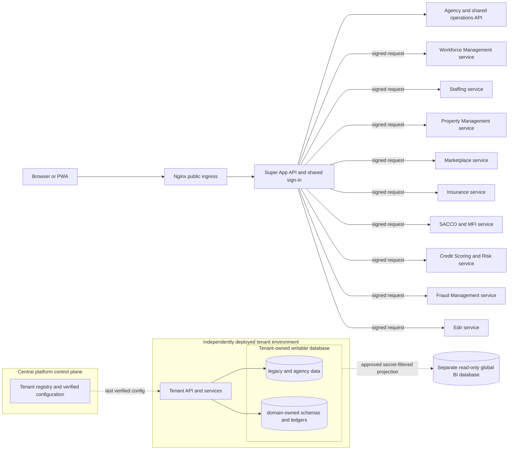

# AfroLife service boundaries and extraction sequence

This document records the proposed ownership boundaries for the Super App. It
does not claim that every boundary is already an independently deployed
microservice. Keep the legacy Agency behavior intact while services are
extracted behind compatible APIs.

## Tenant-owned data and global analytics target

Each platform tenant owns its authoritative database and independently
deployable application environment, on premises or in its chosen cloud. Within
that tenant boundary, domain services may use separately owned schemas and
restricted runtime roles while legacy workflows are retained and migrated
incrementally. A tenant remains operational on its last verified configuration
if it cannot reach the central platform control plane.

The central platform control plane is a registry and configuration authority,
not a tenant data plane. It must not hold tenant database URLs, credentials,
or infrastructure secrets. A tenant may only be marked active after its
deployment is verified; the current registry and verification field do not
provision or independently attest to an actual deployment.

Global BI is a separate read-only analytics database and is the only intended
cross-tenant data exception. The platform now defines a minimized monthly
aggregate catalog, a read-only dashboard API, and a strict projection importer.
Only Global Admin, Super Admin, Finance, and Finance Manager can query the
cross-tenant totals; the UI does not expose tenant-level rows or identifiers.
Projection records contain only tenant IDs, approved metric keys, monthly
aggregate values, units, and projection timestamps. The query role is
read-only; the separately provisioned projector role can write only to the
aggregate store. A 13-month window is enforced by the API and importer.

Tenant-side aggregate extraction, signed/verified tenant enrollment, the
hourly scheduler, replay monitoring, and production source reconciliation are
not implemented or verified yet. Until those controls are deployed, the
dashboard must remain disabled or show no data; never substitute direct
cross-tenant operational queries or the shared-database mirror.

Existing shared-database and legacy-schema access remain transitional until
tenant-by-tenant migration, reconciliation, role grants, rollback, and
disposable UAT have passed. Do not redirect production services or combine
tenant/ledger data based on documentation alone.

## Current deployment boundaries (transition state)

| Domain | Current implementation | Data and operational boundary |
| --- | --- | --- |
| Identity and access | Central API authentication and account management | Owns users, credentials, MFA and server-side sessions. Services must not duplicate passwords or treat a client-supplied role as trusted identity. |
| Agency and shared operations | Leads/contracts/commissions, rent, Admin, privacy, and territory APIs remain mounted in `src/server.ts`. Workforce Management, Staffing, Property Management, and Marketplace have domain-owned route modules and separate runnable API processes with same-origin signed gateways. | The central API composes the routers against the legacy schema for compatibility. Separate service processes require unique `*_DATABASE_URL` values, but their schemas, compatibility APIs, data migration, and reconciliation are not implemented; do not cut over production traffic. |
| SACCO/MFI | `services/sacco-mfi/` service host reuses the injectable router in `src/mfi.ts`; same-origin signed gateway at `/mfi` | Independently runnable backend process with health endpoint, container, and deployment units. It deliberately uses the current restricted AfroLife database role/schema and private document store for a no-data-move cutover; it does not yet have an independently owned database. Production cannot silently fall back to the in-process router. |
| Credit Scoring and Risk Management | Credit scoring, institution policy, and portfolio risk currently run inside SACCO/MFI. | Separate app/service and owned schema are target architecture only; extraction, data ownership, and contracts are incomplete. |
| Fraud Management | No independently deployed Fraud Management service was found in the current service tree. | Separate app/service and owned schema are target architecture only; fraud case, alert, and investigation workflows remain to be designed and implemented. |
| AfroLife Edir | `services/afrolife-edir/` and its gateway | Separate service code and database/migration path; central identity is conveyed through a signed gateway assertion. Deployment and external production evidence remain separate release gates. |
| Insurance | `services/insurance-ledger/` plus the same-origin signed gateway at `/insurance/ledger` and `/insurance/requests` | Separate service process handles ledger and information-request APIs. Ledger facts use the dedicated Insurance database; information requests temporarily use a second restricted connection to the central identity database so existing RLS and request records remain intact. Production requires the service gateway and ledger cutover attestation; no in-process fallback is allowed. |
| Workforce Management | `services/workforce-management/` owns its router, entry point, and TypeScript build; `src/workforce-management.ts` is the canonical module and `src/worker-management.ts` remains a legacy compatibility re-export for `/workers` and `/documents`. Old build/start commands and environment-variable names remain aliases. The existing `afrolife_worker_management` database identifier is retained to avoid moving or losing data. | Independently selectable process and build; still coupled to shared platform helpers and legacy identity, territory, workforce, audit, and notification tables. Owned schema, compatibility contracts, and verified UAT migration remain blocked. |
| Staffing | `services/staffing/` owns its router, entry point, and TypeScript build; `src/staffing.ts` is a legacy compatibility re-export for `/requests` and `/matches`. | Independently selectable process and build; still queries legacy workers, documents, leads, territories, configuration, audit, and notification data directly. Owned schema, cross-service worker/lead contracts, and verified UAT migration remain blocked. |
| Property Management | `services/property-management/` owns its router, entry point, and TypeScript build; `src/property-management.ts` is a legacy compatibility re-export for `/properties`. | Independently selectable process and build; still uses shared identity, territory, lead, marketplace configuration, signup, and audit tables. Owned schema, compatibility contracts, and verified UAT migration remain blocked. |

Property rent, deposits, and refunds remain owned by the shared Agency operations API and post to Accounting after independent Finance reconciliation. Maintenance has a vendor register and accounts-payable workflow: a Finance maker records an invoice, an independent Finance Manager or administrator approves it and posts Expense/Payable, then a separately recorded and reconciled vendor payment posts Payable/Cash. `maintenance_requests.cost` by itself is only an estimate and never posts. Workforce expected rates and Staffing offers/matches are not financial obligations; no payroll or placement revenue is posted until signed terms, work evidence, client billing, and payment workflows exist.
| Marketplace | `services/marketplace/` owns its router, entry point, and TypeScript build; `src/marketplace.ts` is a legacy compatibility re-export for `/marketplace`. | Independently selectable process and build; still uses shared identity, territory, marketplace configuration, signup, audit, and notification tables. Owned schema, compatibility contracts, and verified UAT migration remain blocked. |
| Privacy cases | `src/privacy.ts` | Co-deployed in the central API because requests are tied to central user identity and access policy; not a separate service today. |

## Ownership rules for extraction

- Each tenant owns its writable database, backup/retention policy,
  deployment, and release pipeline. Domain services may have separately
  restricted schemas and runtime roles inside that tenant boundary. The
  current shared legacy schema and local per-service databases are transitional.
  Edir keeps its own backend and ledger schema inside the tenant deployment.
- Cross-service access uses versioned HTTP contracts with authenticated
  service-to-service identity. Do not share database tables or give one
  service's runtime role access to another service's schema. Approved,
  secret-filtered tenant projections are sent through a separate ingestion
  path to the read-only global BI database; that path is not implemented yet.
- Identity remains a central authority. Downstream services receive a signed,
  short-lived identity assertion and independently enforce their own
  authorization and tenant scope. A central identity authority does not grant
  cross-tenant data access.
- Agent specializations are descriptive business metadata, not service
  entitlements. Master and field agents retain access to the property and
  workforce workflows assigned to their existing role; record access and
  staffing actions are enforced against the agent's own records and direct
  team hierarchy. Specialization must not be used as an authorization filter.
- Agents may facilitate commercial and financial workflows by originating
  leads/contracts, submitting supporting documents, recording rent or deposit
  payment references as pending transactions, and tracking progress.
  Facilitation does not post to the ledger or grant authority to reconcile or
  void transactions, approve commissions, issue refunds, or release funds;
  those actions remain with the designated finance or platform approval roles.
- Workforce Management, Staffing, Property Management, and Marketplace keep
  route implementations and entry points in their service folders and have
  individual TypeScript build targets. The central `src/` modules re-export
  those routers for backwards-compatible composition. The services still use
  shared platform libraries and legacy-schema queries; no owned service schema
  or verified UAT record migration has shipped. A configured URL alone does not
  make a service database ready.
- Financial services own their ledger facts and idempotency keys in their
  isolated schemas. Cross-domain financial effects use explicit, reconcilable
  events or APIs; they must not write directly into another service's ledger.
- A service is not considered independently deployable until its API contract,
  schema ownership, migration/rollback strategy, operational alerts, restore
  test, compatibility test, and production role grants are verified.

## Safe extraction sequence

1. Stabilize and version the existing Edir and Insurance service contracts;
   define the target schemas and reconciliation plan before consolidating any
   current isolated ledger database into the shared database.
2. Keep identity as the shared control plane and extract one bounded domain at
   a time. SACCO/MFI now has an independently runnable API process and signed
   gateway route. Preserve its ledger and private document data while migrating
   into a dedicated schema in the shared database; validate reconciliation
   before cutover.
3. Worker Management, Staffing, Property Management, and Marketplace now have
   service-local routers, individual build targets, runnable processes, and
   signed gateway routes. Keep the central API composition as the legacy
   compatibility path. Before production cutover, replace direct cross-domain
   SQL dependencies with versioned APIs/events, define owned schemas in the
   shared database, migrate and reconcile approved scrubbed UAT fixtures,
   create restricted roles and grants, verify file-store access, exercise
   route parity and rollback, and establish backup/restore and monitoring
   evidence.
4. Keep shared privacy/identity administration centralized unless an approved
   ownership model defines how the central data subject, consent, retention,
   and incident workflows span independent services.

The current platform is therefore a hybrid modular system with seven
independently runnable domain processes, not yet a fully decomposed
microservice estate. MFI and the Insurance request inbox retain central
database dependencies. The four Agency-domain services now have service-local
route code and individual build targets but still depend on shared libraries
and legacy-schema data. Their owned schemas, cross-service contracts, and data
migration paths are incomplete. These are explicit release gates, not
completed database separation.
Architecture changes must be gated by data ownership and compatibility tests,
not by moving files or splitting processes alone.

## Public ingress and internal routing

The browser uses one origin, one sign-in, and the existing shared shell,
localization, and responsive navigation. Nginx is the public ingress and
forwards the site and `/api/v1/*` to the central API only. The API authenticates
the session and dispatches configured service routes using short-lived signed
identity assertions. Edir remains behind `/edir` as a separate ledger-backed
service. Edir and Insurance currently use separate physical ledger databases;
their eventual placement within each tenant's owned database requires a
tenant-by-tenant migration and reconciliation.
Insurance and MFI keep their public API paths under the same origin. Backend
ports are loopback/private and must not be published directly.

Nginx service-specific locations are public-edge routing groups, not direct
upstreams to financial processes. They terminate at the same Super App API,
which authenticates sessions, signs service requests, and dispatches to private
service URLs. This avoids duplicating identity policy in Kong/Nginx and blocks
direct access to service ports.



The shared frontend continues to use one browser origin and one session.
Insurance, MFI, Edir, Workforce Management, Staffing, Property Management, and
Marketplace are separate backend processes behind the central identity gateway.
The gateway and domain API processes are still coupled to legacy shared
identity and data; the diagram describes the target topology, not a completed
tenant deployment. The four Agency domain services preserve old routes through
the central compatibility composition. Tenant database provisioning,
independent operation, and the BI projection remain under implementation and
validation.

Do not add Kong alongside the current Nginx-to-central-gateway chain by
default: that duplicates the ingress/gateway role without improving this
single-host deployment. Revisit Kong or another service mesh when deployment
needs include multi-node routing, service discovery, independent gateway
policies, or traffic management that the current central API gateway cannot
provide.

MFI service cutover uses `MFI_SERVICE_URL`; production requires this setting
and `MFI_GATEWAY_SECRET` whenever the pilot is enabled. The standalone service
uses the existing MFI router and RLS-scoped transaction helper, so the API
contract and ledger records remain unchanged. For initial rollout, point
`MFI_DATABASE_URL` at the same restricted AfroLife database used by the legacy
API and keep the private document directory identical. This separates process
and deployment lifecycle without moving financial data. The target is a
restricted MFI schema inside the shared database, not a separate physical
database. Do not point it at an empty database or claim schema ownership until
the migration, identity-reference design, ledger reconciliation, rollback,
and compatibility test have passed.

### Agency domain service processes

The unified web and Super App frontend keeps a shared session, navigation,
localization, and same-origin API gateway. Domain mini-app descriptors live
under `public/mini-apps/<service>/`; the shared workspace launcher reads their
panel names, labels, descriptions, and gateway API prefixes. This keeps the
module directory ownership aligned across UI and backend without creating
separate sign-in or public origins.

Build each service independently with `npm run build:workforce-management`,
`npm run build:staffing`, `npm run build:property-management`, or
`npm run build:marketplace`. `npm run build:agency-domains` runs all four.
Each service entry point loads only its own router after selecting its service
database; the central API continues to import compatibility re-exports under
`src/`.

The frontend descriptors and service-local routers are modularization steps,
not yet full-stack data ownership. Database migrations remain in the legacy
`migrations/` chain, the route modules still query legacy tables directly,
and the service databases contain only a minimal anonymized local UAT subset
from `scripts/migrate-agency-domains-uat.mjs`. Comprehensive reconciliation,
service-owned migrations, and copied document/media fixtures remain
incomplete. Do not describe these processes as fully autonomous services until each
has service-owned migrations/schema, explicit inter-service contracts, tested
UAT fixtures, and backup/restore and rollback coverage.
Start individual processes with `npm run start:workforce-management`,
`npm run start:staffing`, `npm run start:property-management`, or
`npm run start:marketplace`; default loopback ports are 3400, 3401, 3402, and
3403. Each process loads only its domain router and requires its matching
service-specific database URL (`WORKFORCE_MANAGEMENT_DATABASE_URL` or the
legacy `WORKER_MANAGEMENT_DATABASE_URL`,
`STAFFING_DATABASE_URL`, `PROPERTY_MANAGEMENT_DATABASE_URL`, or
`MARKETPLACE_DATABASE_URL`), `FILE_STORAGE_DIR` (for document/media services),
and matching `*_GATEWAY_SECRET`. Configure the same service URLs and matching
secrets on the central API as `WORKER_MANAGEMENT_SERVICE_URL`,
`STAFFING_SERVICE_URL`, `PROPERTY_MANAGEMENT_SERVICE_URL`, and
`MARKETPLACE_SERVICE_URL`.

For local schema preparation, run `npm run db:agency-domains:local:setup` from
the `afrolife` directory. It only accepts the configured local
`127.0.0.1:5433/afrolife` source, refuses to overwrite any existing target
database, creates a restricted runtime role for each domain, and applies the
current migration chain. It writes private service environment files but does
not copy application records or set service URLs on the central API.
This separate-database setup is a transitional isolation/UAT harness, not a
complete tenant deployment. It can help verify restricted service roles but
does not provision a tenant-owned application environment or the separate BI
store; do not use it to declare tenant isolation or migration complete.
To re-apply the service-specific grants to already-created local targets, run
`npm run db:agency-domains:local:harden`. It revokes legacy-wide grants and
allows only the domain's required tables and columns. Service startup rejects
runtime roles that can read authentication secrets, create schema objects, or
access MFI/Insurance ledger tables.

These databases currently hold the legacy schema and a minimal anonymized UAT
subset, not independently owned domain schemas or reconciled service data.
The routers still query shared
identity, territory, lead, configuration, audit, and notification tables;
cross-service compatibility APIs and data migrations are not implemented.
Startup checks the minimum required tables, RLS state, and service-role
privilege boundaries, but passing those checks does not establish data parity
or independent operation. Keep gateway
service URLs unset until schemas, records, cross-service contracts,
reconciliation, and rollback are implemented and verified. Do not reuse a
superuser, table-owner, or
`BYPASSRLS` runtime role. An unset URL retains the existing central-router
path; configuring a URL is the explicit cutover, and failures from a configured
service are not hidden by automatic fallback. Set a private HTTPS URL for
remote hosts; loopback HTTP is only for same-host development. Keep all service
ports private and route public traffic through the central API gateway.

Each Agency-domain gateway also requires its matching
`*_SERVICE_CUTOVER_READY=1` setting, a valid private service origin, and a
unique strong gateway secret before the central API will start with that
service URL configured. Leave the setting at `0` while a service stays on the
legacy router. This is an explicit operator attestation that the release gates
were reviewed; it does not perform or prove schema ownership, data migration,
reconciliation, route parity, backup restoration, rollback, monitoring, or
production approval. Never set it to `1` solely to make deployment start.

Build one service-specific image from the app directory, for example:

```sh
docker build -f services/agency-domain/Dockerfile \
  --build-arg SERVICE_NAME=worker-management \
  -t afrolife-worker-management .
```

Use `staffing`, `property-management`, or `marketplace` as `SERVICE_NAME` for
the other images. The build compiles the selected service entry point and
router with its imported shared platform modules. Supply each service's
database URL, gateway secret, and private storage mount as deployment secrets;
never bake them into images.

## Request correlation

The API creates a UUID correlation ID for each request unless the caller supplied a valid UUID in X-AfroLife-Correlation-Id. The ID is returned in that response header, included in API error responses, and forwarded by the central gateway to Edir, Insurance, and SACCO/MFI services. It is diagnostic metadata only; authorization, tenant scope, and financial idempotency remain governed by their existing controls.
