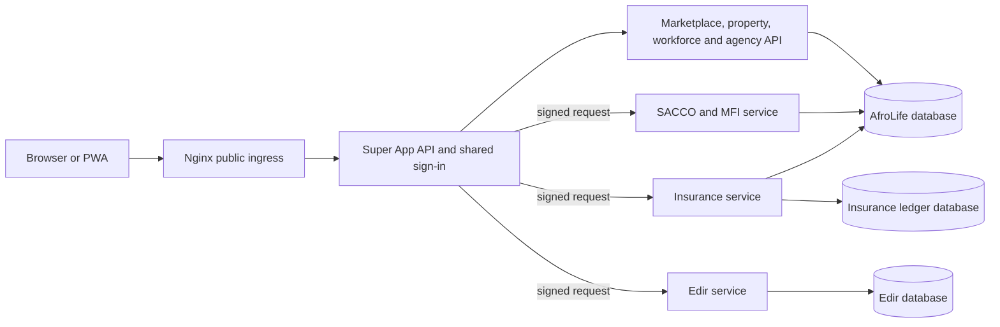

# AfroLife service boundaries and extraction sequence

This document records the proposed ownership boundaries for the Super App. It
does not claim that every boundary is already an independently deployed
microservice. Keep the legacy Agency behavior intact while services are
extracted behind compatible APIs.

## Current deployment boundaries

| Domain | Current implementation | Data and operational boundary |
| --- | --- | --- |
| Identity and access | Central API authentication and account management | Owns users, credentials, MFA and server-side sessions. Services must not duplicate passwords or treat a client-supplied role as trusted identity. |
| Agency and shared operations | Routers mounted in `src/server.ts` | Co-deployed with the central API and central PostgreSQL schema; includes leads, workforce, contracts, Marketplace, rent, Admin, and privacy operations. |
| SACCO/MFI | `services/sacco-mfi/` service host reuses the injectable router in `src/mfi.ts`; same-origin signed gateway at `/mfi` | Independently runnable backend process with health endpoint, container, and deployment units. It deliberately uses the current restricted AfroLife database role/schema and private document store for a no-data-move cutover; it does not yet have an independently owned database. Production cannot silently fall back to the in-process router. |
| AfroLife Edir | `services/afrolife-edir/` and its gateway | Separate service code and database/migration path; central identity is conveyed through a signed gateway assertion. Deployment and external production evidence remain separate release gates. |
| Insurance | `services/insurance-ledger/` plus the same-origin signed gateway at `/insurance/ledger` and `/insurance/requests` | Separate service process handles ledger and information-request APIs. Ledger facts use the dedicated Insurance database; information requests temporarily use a second restricted connection to the central identity database so existing RLS and request records remain intact. Production requires the service gateway and ledger cutover attestation; no in-process fallback is allowed. |
| Privacy cases | `src/privacy.ts` | Co-deployed in the central API because requests are tied to central user identity and access policy; not a separate service today. |

## Ownership rules for extraction

- The target state is for each service to own its schema, migration account,
  restricted runtime account, backups, retention, health/readiness endpoint,
  and release pipeline. SACCO/MFI is a documented transitional exception:
  its process is separated, but it still uses the existing shared schema and
  private document store to avoid moving ledger data.
- Cross-service access uses versioned HTTP contracts with authenticated
  service-to-service identity. Do not share database tables or give one
  service's runtime role access to another service's schema.
- Identity remains a central authority. Downstream services receive a signed,
  short-lived identity assertion and independently enforce their own
  authorization and tenant scope.
- Financial services own their ledger facts and idempotency keys. Cross-domain
  financial effects use explicit, reconcilable events or APIs; they must not
  write directly into another service's ledger.
- A service is not considered independently deployable until its API contract,
  schema ownership, migration/rollback strategy, operational alerts, restore
  test, compatibility test, and production role grants are verified.

## Safe extraction sequence

1. Stabilize and version the existing Edir and Insurance service contracts;
   finish isolated-database and reconciliation gates before switching traffic.
2. Keep identity as the shared control plane and extract one bounded domain at
   a time. SACCO/MFI now has an independently runnable API process and signed
   gateway route, while its database and private document store remain shared
   to preserve the current member and ledger records. Any later database
   isolation requires an approved SRS scope and migration/reconciliation plan.
3. Extract Agency domains only after mapping their shared contracts and data
   dependencies. Preserve existing endpoints during transition and verify
   parity before retiring any legacy route.
4. Keep shared privacy/identity administration centralized unless an approved
   ownership model defines how the central data subject, consent, retention,
   and incident workflows span independent services.

The current platform is therefore a hybrid modular system with three
independently runnable financial service backends, not yet a fully decomposed
microservice estate. MFI and the Insurance request inbox still have central
database dependencies; these are documented transitional boundaries, not
independent database ownership.
Architecture changes must be gated by data ownership and compatibility tests,
not by moving files or splitting processes alone.

## Public ingress and internal routing

The browser uses one origin, one sign-in, and the existing shared shell,
localization, and responsive navigation. Nginx is the public ingress and
forwards the site and `/api/v1/*` to the central API only. The API authenticates
the session and dispatches configured service routes using short-lived signed
identity assertions. Edir remains behind `/edir`; its service and database are
unchanged. Insurance and MFI keep their public API paths under the same origin.
Backend ports are loopback/private and must not be published directly.

Nginx service-specific locations are public-edge routing groups, not direct
upstreams to financial processes. They terminate at the same Super App API,
which authenticates sessions, signs service requests, and dispatches to private
service URLs. This avoids duplicating identity policy in Kong/Nginx and blocks
direct access to service ports.

The shared frontend continues to use one browser origin and one session.
Insurance and MFI run separately from Marketplace and workforce at the API
process level. MFI data and Insurance request-intake records still depend on
the central database during migration; Insurance ledger and Edir records have
separate databases.

Do not add Kong alongside the current Nginx-to-central-gateway chain by
default: that duplicates the ingress/gateway role without improving this
single-host deployment. Revisit Kong or another service mesh when deployment
needs include multi-node routing, service discovery, independent gateway
policies, or traffic management that the current central API gateway cannot
provide.

MFI service cutover uses `MFI_SERVICE_URL`; production requires this setting
and `MFI_GATEWAY_SECRET` whenever the pilot is enabled. The standalone service
uses the existing MFI router and RLS-scoped transaction helper, so the API
contract and ledger records remain unchanged. For initial rollout, point
`MFI_DATABASE_URL` at the same restricted AfroLife database used by the legacy
API and keep the private document directory identical. This separates process
and deployment lifecycle without moving financial data. Do not point it at an
empty database or claim database isolation; a future independent database
requires a separately approved schema migration, identity-reference design,
ledger reconciliation, rollback, and compatibility test.
