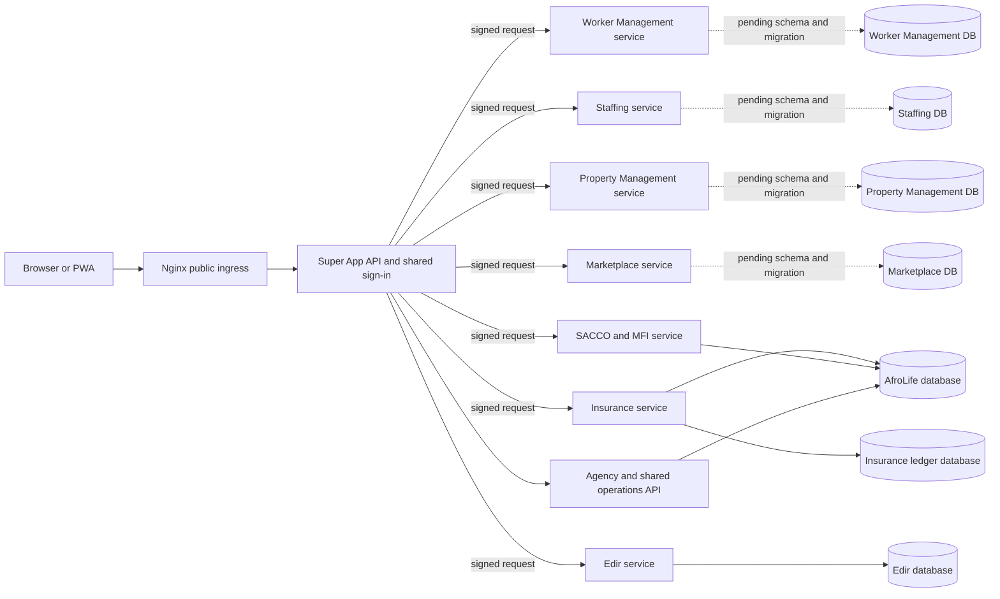

# AfroLife service boundaries and extraction sequence

This document records the proposed ownership boundaries for the Super App. It
does not claim that every boundary is already an independently deployed
microservice. Keep the legacy Agency behavior intact while services are
extracted behind compatible APIs.

## Current deployment boundaries

| Domain | Current implementation | Data and operational boundary |
| --- | --- | --- |
| Identity and access | Central API authentication and account management | Owns users, credentials, MFA and server-side sessions. Services must not duplicate passwords or treat a client-supplied role as trusted identity. |
| Agency and shared operations | Leads/contracts/commissions, rent, Admin, privacy, and territory APIs remain mounted in `src/server.ts`. Worker Management, Staffing, Property Management, and Marketplace have domain-owned route modules and separate runnable API processes with same-origin signed gateways. | The central API composes the routers against the legacy schema for compatibility. Separate service processes require unique `*_DATABASE_URL` values, but their schemas, compatibility APIs, data migration, and reconciliation are not implemented; do not cut over production traffic. |
| SACCO/MFI | `services/sacco-mfi/` service host reuses the injectable router in `src/mfi.ts`; same-origin signed gateway at `/mfi` | Independently runnable backend process with health endpoint, container, and deployment units. It deliberately uses the current restricted AfroLife database role/schema and private document store for a no-data-move cutover; it does not yet have an independently owned database. Production cannot silently fall back to the in-process router. |
| AfroLife Edir | `services/afrolife-edir/` and its gateway | Separate service code and database/migration path; central identity is conveyed through a signed gateway assertion. Deployment and external production evidence remain separate release gates. |
| Insurance | `services/insurance-ledger/` plus the same-origin signed gateway at `/insurance/ledger` and `/insurance/requests` | Separate service process handles ledger and information-request APIs. Ledger facts use the dedicated Insurance database; information requests temporarily use a second restricted connection to the central identity database so existing RLS and request records remain intact. Production requires the service gateway and ledger cutover attestation; no in-process fallback is allowed. |
| Worker Management | `src/worker-management.ts`, loaded by `services/worker-management/`, serves `/workers` and `/documents`. | Route code and process are separated. Service-owned schema and verified record migration remain blocked; routes still expect legacy identity, territory, and workforce tables. |
| Staffing | `src/staffing.ts`, loaded by `services/staffing/`, serves `/requests` and `/matches`. | Route code and process are separated. Service-owned schema, worker-eligibility compatibility APIs, and verified record migration remain blocked; staffing still depends on worker, lead, territory, and matching-rule data. |
| Property Management | `src/property-management.ts`, loaded by `services/property-management/`, serves `/properties`. | Route code and process are separated. Service-owned schema and verified record migration remain blocked; property operations still expect legacy identity, territory, and marketplace configuration data. |
| Marketplace | `src/marketplace.ts`, loaded by `services/marketplace/`, serves `/marketplace`. | Route code and process are separated. Service-owned schema and verified record migration remain blocked; marketplace operations still expect legacy identity, territory, and configuration data. |
| Privacy cases | `src/privacy.ts` | Co-deployed in the central API because requests are tied to central user identity and access policy; not a separate service today. |

## Ownership rules for extraction

- The target state is for each service to own its schema, migration account,
  restricted runtime account, backups, retention, health/readiness endpoint,
  and release pipeline. SACCO/MFI is a documented transitional exception:
  its process is separated, but it still uses the existing shared schema and
  private document store to avoid moving ledger data.
- Cross-service access uses versioned HTTP contracts with authenticated
  service-to-service identity. Do not share database tables or give one
  service's runtime role access to another service's schema.
- Identity remains a central authority. Downstream services receive a signed,
  short-lived identity assertion and independently enforce their own
  authorization and tenant scope.
- Worker Management, Staffing, Property Management, and Marketplace now have
  separate route modules and runtimes. Their dedicated database URL variables
  are mandatory, but no domain database migration or live record copy has
  shipped; a configured URL alone does not make a service database ready.
- Financial services own their ledger facts and idempotency keys. Cross-domain
  financial effects use explicit, reconcilable events or APIs; they must not
  write directly into another service's ledger.
- A service is not considered independently deployable until its API contract,
  schema ownership, migration/rollback strategy, operational alerts, restore
  test, compatibility test, and production role grants are verified.

## Safe extraction sequence

1. Stabilize and version the existing Edir and Insurance service contracts;
   finish isolated-database and reconciliation gates before switching traffic.
2. Keep identity as the shared control plane and extract one bounded domain at
   a time. SACCO/MFI now has an independently runnable API process and signed
   gateway route, while its database and private document store remain shared
   to preserve the current member and ledger records. Any later database
   isolation requires an approved SRS scope and migration/reconciliation plan.
3. Worker Management, Staffing, Property Management, and Marketplace now have
   separate route modules, runnable processes, and signed gateway routes. Keep
   the central API composition as the legacy compatibility path. Before
   production cutover, define owned schemas and cross-service compatibility
   contracts, migrate and reconcile records without cross-database foreign
   keys, create restricted roles and grants, verify file-store access, exercise
   route parity and rollback, and establish backup/restore and monitoring
   evidence.
4. Keep shared privacy/identity administration centralized unless an approved
   ownership model defines how the central data subject, consent, retention,
   and incident workflows span independent services.

The current platform is therefore a hybrid modular system with seven
independently runnable domain processes, not yet a fully decomposed
microservice estate. MFI and the Insurance request inbox retain central
database dependencies. The four Agency-domain services have domain-owned route
code and service-specific database configuration, but their required owned
schemas and migration paths are still incomplete. These are explicit release
gates, not completed database separation.
Architecture changes must be gated by data ownership and compatibility tests,
not by moving files or splitting processes alone.

## Public ingress and internal routing

The browser uses one origin, one sign-in, and the existing shared shell,
localization, and responsive navigation. Nginx is the public ingress and
forwards the site and `/api/v1/*` to the central API only. The API authenticates
the session and dispatches configured service routes using short-lived signed
identity assertions. Edir remains behind `/edir`; its service and database are
unchanged. Insurance and MFI keep their public API paths under the same origin.
Backend ports are loopback/private and must not be published directly.

Nginx service-specific locations are public-edge routing groups, not direct
upstreams to financial processes. They terminate at the same Super App API,
which authenticates sessions, signs service requests, and dispatches to private
service URLs. This avoids duplicating identity policy in Kong/Nginx and blocks
direct access to service ports.



The shared frontend continues to use one browser origin and one session.
Insurance, MFI, Edir, Worker Management, Staffing, Property Management, and
Marketplace are separate backend processes behind the central identity gateway.
The four Agency domain services preserve the old routes through the central
compatibility composition. Their isolated runtimes require distinct database
URLs, but their schemas and data migrations are not complete.

Do not add Kong alongside the current Nginx-to-central-gateway chain by
default: that duplicates the ingress/gateway role without improving this
single-host deployment. Revisit Kong or another service mesh when deployment
needs include multi-node routing, service discovery, independent gateway
policies, or traffic management that the current central API gateway cannot
provide.

MFI service cutover uses `MFI_SERVICE_URL`; production requires this setting
and `MFI_GATEWAY_SECRET` whenever the pilot is enabled. The standalone service
uses the existing MFI router and RLS-scoped transaction helper, so the API
contract and ledger records remain unchanged. For initial rollout, point
`MFI_DATABASE_URL` at the same restricted AfroLife database used by the legacy
API and keep the private document directory identical. This separates process
and deployment lifecycle without moving financial data. Do not point it at an
empty database or claim database isolation; a future independent database
requires a separately approved schema migration, identity-reference design,
ledger reconciliation, rollback, and compatibility test.

### Agency domain service processes

Build the Agency domain services together with `npm run build:agency-domains`.
Start individual processes with `npm run start:worker-management`,
`npm run start:staffing`, `npm run start:property-management`, or
`npm run start:marketplace`; default loopback ports are 3400, 3401, 3402, and
3403. Each process loads only its domain router and requires its matching
service-specific database URL (`WORKER_MANAGEMENT_DATABASE_URL`,
`STAFFING_DATABASE_URL`, `PROPERTY_MANAGEMENT_DATABASE_URL`, or
`MARKETPLACE_DATABASE_URL`), `FILE_STORAGE_DIR` (for document/media services),
and matching `*_GATEWAY_SECRET`. Configure the same service URLs and matching
secrets on the central API as `WORKER_MANAGEMENT_SERVICE_URL`,
`STAFFING_SERVICE_URL`, `PROPERTY_MANAGEMENT_SERVICE_URL`, and
`MARKETPLACE_SERVICE_URL`.

For local schema preparation, run `npm run db:agency-domains:local:setup` from
the `afrolife` directory. It only accepts the configured local
`127.0.0.1:5433/afrolife` source, refuses to overwrite any existing target
database, creates a restricted runtime role for each domain, and applies the
current migration chain. It writes private service environment files but does
not copy application records or set service URLs on the central API.
To re-apply the service-specific grants to already-created local targets, run
`npm run db:agency-domains:local:harden`. It revokes legacy-wide grants and
allows only the domain's required tables and columns. Service startup rejects
runtime roles that can read authentication secrets, create schema objects, or
access MFI/Insurance ledger tables.

These databases currently hold the legacy schema, not independently owned
domain schemas or reconciled service data. The routers still query shared
identity, territory, lead, configuration, audit, and notification tables;
cross-service compatibility APIs and data migrations are not implemented.
Startup checks the minimum required tables, RLS state, and service-role
privilege boundaries, but passing those checks does not establish data parity
or independent operation. Keep gateway
service URLs unset until schemas, records, cross-service contracts,
reconciliation, and rollback are implemented and verified. Do not reuse a
superuser, table-owner, or
`BYPASSRLS` runtime role. An unset URL retains the existing central-router
path; configuring a URL is the explicit cutover, and failures from a configured
service are not hidden by automatic fallback. Set a private HTTPS URL for
remote hosts; loopback HTTP is only for same-host development. Keep all service
ports private and route public traffic through the central API gateway.

The shared domain image is built from the app directory, for example:

```sh
docker build -f services/agency-domain/Dockerfile \
  --build-arg SERVICE_NAME=worker-management \
  -t afrolife-worker-management .
```

Use `staffing`, `property-management`, or `marketplace` as `SERVICE_NAME` for
the other service images. Supply each service's database URL, gateway secret,
and private storage mount as deployment secrets; never bake them into images.

## Request correlation

The API creates a UUID correlation ID for each request unless the caller supplied a valid UUID in X-AfroLife-Correlation-Id. The ID is returned in that response header, included in API error responses, and forwarded by the central gateway to Edir, Insurance, and SACCO/MFI services. It is diagnostic metadata only; authorization, tenant scope, and financial idempotency remain governed by their existing controls.
